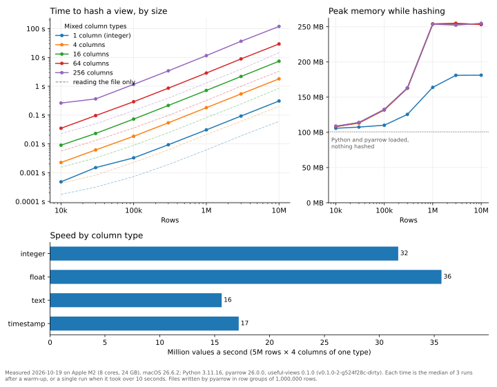

useful-views calls a short code computed from something's contents a
**fingerprint**. A view has two: a **file hash**, computed from the file's
bytes, and a **data hash**, computed from its *contents*, its columns and its
values. This page sets the rules for the data hash. Unlike the file hash, it
does not depend on the library that wrote the file, its version, or how the
file is compressed and encoded. Two parquet files that hold the same table
have the same data hash. For why this matters, see
[Stale views and fingerprints](../concepts/stale-views.md) and
[Try it: two fingerprints](../guides/fingerprints.md).

`data_hash` computes it for any parquet file:

```python
import useful_views as uvs

uvs.data_hash("useful-views/gdp-per-capita.parquet")
```

useful-views does not record data hashes yet. These rules come first, so
that every version of useful-views, on every computer, and any other program
that follows them, computes the same hash for the same table.

## In short

- Every column in the file counts, in the order the file stores them, with
  its name and type. No column is special.
- Every row counts, in the order the file stores them.
- Values count exactly. The only exceptions: every NaN is the same NaN, and
  `-0.0` is `0.0`.
- Text is text, however a library stores it (`string`, `large_string`,
  `string_view`). Number types stay distinct: an `int32` column is not an
  `int64` column, and `float32` is not `float64`.
- How the file was written does not count: the library and its version,
  compression, encodings, row groups, dictionary encoding, statistics and
  metadata.
- Version 1 covers flat tables. A file with a nested column (a list, a struct
  or a map in each cell) has no data hash, and `data_hash` raises a
  `DataHashError` naming the column.

## Format

A data hash is written as

```text
datahash1:sha256:<64 lowercase hexadecimal digits>
```

`datahash1` names these rules. If the rules ever change, the new rules get a
new name (`datahash2`), and hashes made under different rules are never
compared.

## The byte stream

All numbers are written little-endian. "Length-prefixed" means: the length in
bytes as an unsigned 64-bit integer, then the bytes.

Each column is hashed on its own first. A column's **digest** is the SHA-256
of its rows, one after another, in file order, each encoded as described
below. The data hash is then the SHA-256 of:

1. The ASCII bytes `datahash1`, then one newline byte (`0x0A`).
2. The number of rows, as an unsigned 64-bit integer.
3. The number of columns, as an unsigned 64-bit integer.
4. For each column, in file order: its name (UTF-8, length-prefixed), its
   canonical type name (ASCII, length-prefixed; see below), and its digest
   (32 bytes).

Hashing each column on its own means a large view can be read one column
at a time, and a later version of useful-views could say which columns
changed.

Each row starts with one byte: `0x00` if the value is missing (null), `0x01`
if it is present. A missing value has nothing after that byte. A present
value is followed by its encoding.

## Types and values

The type in the file is reduced to a canonical type name. The value is
encoded by the canonical type.

| Types in the file | Canonical name | A present value is encoded as |
|---|---|---|
| `null` (a column with no values at all) | `null` | (every value is missing) |
| `bool` | `bool` | one byte: `0x00` false, `0x01` true |
| `int8`, `int16`, `int32`, `int64` | the same name | signed 64-bit integer |
| `uint8`, `uint16`, `uint32`, `uint64` | the same name | unsigned 64-bit integer |
| `float16`, `float32`, `float64` | the same name | the value converted exactly to a 64-bit float (IEEE 754 binary64), as 8 bytes; every NaN is written with the bit pattern `0x7FF8000000000000`, and `-0.0` as `0.0` |
| `decimal32(p, s)`, `decimal64(p, s)`, `decimal128(p, s)`, `decimal256(p, s)` | `decimal(p,s)` | the unscaled integer (the value times 10<sup>s</sup>), as a signed 256-bit integer: 32 bytes, two's complement |
| `string`, `large_string`, `string_view` | `string` | UTF-8, length-prefixed |
| `binary`, `large_binary`, `binary_view`, `fixed_size_binary(n)` | `binary` | the bytes, length-prefixed |
| `date32`, `date64` | `date` | days since 1970-01-01, as a signed 64-bit integer (for `date64`, its milliseconds divided by 86,400,000, rounded down) |
| `timestamp(unit)` | `timestamp` | the instant as whole seconds since 1970-01-01T00:00:00 (signed 64-bit) and the nanoseconds within that second (unsigned 32-bit, 0 to 999,999,999) |
| `timestamp(unit, tz)` | `timestamp[tz]`, with the time zone as stored, such as `timestamp[UTC]` | as above; the stored instant is already in UTC |
| `time32(unit)`, `time64(unit)` | `time` | nanoseconds since midnight, as a signed 64-bit integer |
| `duration(unit)` | `duration` | whole seconds (signed 64-bit) and nanoseconds within the second (unsigned 32-bit) |
| `dictionary(index, value)` | the canonical name of `value` | the value it stands for |
| anything else: lists, structs, maps, unions, intervals, extension types | not covered | the file has no data hash in version 1 |

Seconds and nanoseconds are found by floor division, so an instant before
1970 has negative seconds and a non-negative nanosecond part. A timestamp
stored in milliseconds and the same instant stored in microseconds or
nanoseconds therefore encode the same way.

## Not part of the hash

- the file's bytes, format version, compression, encodings and page layout;
- row groups and how the table is split into batches;
- dictionary encoding, and whether a column is marked nullable;
- column statistics, and schema and column metadata, including the library
  that wrote the file and pandas' own metadata.

pandas saves its row index as an extra column, named like
`__index_level_0__`, unless it is the default 0, 1, 2, …. That column is in
the file, so it counts, like any other. To leave it out, write with
`index=False`.

## Speed



The figure shows `data_hash` on one computer, an Apple M2 laptop, named
under the figure.

- **Time** (top left), for views of growing size with a mix of integer,
  float, text and timestamp columns. The lines are straight and evenly
  spaced: the time grows in step with the number of values, rows times
  columns, at about 22 million values a second. A view of 10 million rows
  and 4 columns takes about 2 seconds; one of 10 million rows and 256
  columns, 2.56 billion values and 15 GB on disk, takes 2 minutes. The dashed
  lines are the time to read the same file a column at a time, as
  `data_hash` does. Hashing takes about 9 times as long, because every value
  is encoded.
- **Memory** (top right). `data_hash` reads one column of one row group at a
  time, never the whole table. Its memory grows with the number of rows only
  until a view fills one row group, a million rows in these files, then
  stays level however many rows and columns follow: about 250 MB, of which
  about 100 MB is Python with pyarrow loaded. The 15 GB view needed no more
  memory than a 23 MB one.
- **Column types** (bottom). Text and timestamps take about twice as long
  per value as integers and floats.

How much memory depends on the file's row groups, which the library that
wrote it chose: pyarrow and pandas write up to about a million rows per row
group, and polars fewer. The same view of 10 million rows and 4 columns,
written as a single row group, needs 1.3 GB instead of 250 MB, in the same
time.

The figure is made by `scripts/benchmark_data_hash.py` in the useful-views
repository, which also saves every timing and peak memory, with the computer
and versions, in [data-hash-speed.json](data-hash-speed.json).

To time it on your computer:

```python
import time

import polars as pl
import useful_views as uvs

n = 5_000_000
frame = pl.select(
    id=pl.int_range(n),
    x=pl.int_range(n) / 7,
    name=pl.format("station-{}", pl.int_range(n) % 997),
    when=pl.datetime_range(pl.datetime(2020, 1, 1), pl.datetime(2020, 1, 1) + pl.duration(seconds=n - 1), "1s"),
)
frame.write_parquet("big.parquet")

start = time.perf_counter()
uvs.data_hash("big.parquet")
print(f"{time.perf_counter() - start:.1f} seconds")
```

## Test vectors

The sensor readings from [Try it: two fingerprints](../guides/fingerprints.md),
with `station` and `time` as text and `temp_c` as a 64-bit float:

| station | time | temp_c |
|---|---|---|
| A | 06:00 | 14.2 |
| A | 07:00 | 15.1 |
| B | 06:00 | 56.8 |
| B | 07:00 | (missing) |

have the data hash

```text
datahash1:sha256:76c92a8bef6fae8ffaffcd6a3558af6146eee1f608168632539e42accdebbc18
```

whether polars, pyarrow or pandas wrote the file. The useful-views
repository keeps this table in three files, one from each library, and two
more: a table with every type above, and an empty one. They are in
`tests/data/datahash/`, with their hashes in `tests/test_data_hash.py`. The
tests check them on every supported pyarrow version, on Linux, macOS and
Windows, against `data_hash` and against a second, plain implementation
written straight from this page. To implement these rules in another
language, start from those files.

## Promises

- These rules never change. A different rule gets a different name.
- When nested columns are covered, it will be by extending these rules: a
  table with no nested column keeps exactly the same hash.
